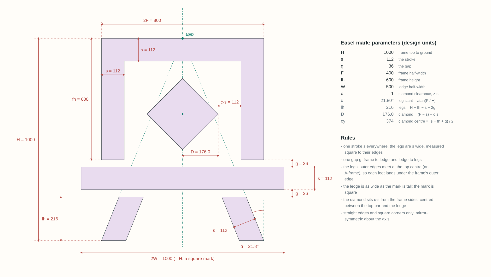

# The easel mark: construction

Design units: the mark is 1000 tall, from the frame's top to the ground. y points down, and the axis is x = 0.

## Parameters

| Name | Value | Meaning |
|---|---|---|
| H | 1000 | frame top to the ground |
| s | 112 | the one stroke: top bar, frame sides, ledge and legs |
| g | 36 | the one gap: frame to ledge, ledge to legs |
| F | 400 | the frame's half-width |
| fh | 600 | the frame's height, top to its feet |
| W | 500 | the ledge's half-width; W = H / 2 makes the mark square |
| c | 1.0 | the diamond's clearance from the frame sides, as a share of s |

| Derived | Value | From |
|---|---|---|
| α | 21.80° | the legs' slant, atan(F / H) |
| lh | 216 | the legs' height, H − fh − s − 2g |
| D | 176.0 | the diamond's half-diagonal, (F − s) − c·s |
| cy | 374 | the diamond's centre, (s + fh + g) / 2 |

[easel-mark.params.json](easel-mark.params.json) holds the seven parameters.

## Steps

1. **The frame.** Start from the rectangle from (−F, 0) to (F, fh). Subtract the rectangle from (−F + s, s) to
   (F − s, fh). That leaves a top bar and two sides, all s wide, open at the bottom.
2. **The ledge.** Add the rectangle from (−W, fh + g) to (W, fh + g + s): one gap below the frame's feet, as
   wide as the mark is tall.
3. **The legs.** Each leg runs from one gap below the ledge to the ground. Its outer edge lies on the line from
   the top centre (0, 0) to (±F, H), the apex of an A-frame, so each foot lands under the frame's outer edge.
   A leg is s wide measured square to its edges, which is s / cos α = 120.6 measured across.
4. **The diamond.** Add a square standing on its corner, with half-diagonal D, centred on the axis midway
   between the top bar's underside (y = s) and the ledge's top (y = fh + g). Its side points sit c·s = 112 from
   the frame sides.

## Rules

- One stroke s everywhere. The legs are s wide, measured square to their edges.
- One gap g, from frame to ledge and from ledge to legs.
- The legs' outer edges meet at the top centre.
- The ledge is as wide as the mark is tall: the mark is square.
- The diamond sits c·s from the frame sides, centred between the top bar and the ledge.
- Straight edges and square corners only.
- Mirror-symmetric about the axis.

## The small cut

For 48 px and below: s 140, g 70, fh 520, c 0.8. The heavier strokes and wider gaps survive at 16 px. The
shorter frame leaves the legs room ([easel-mark-small.params.json](easel-mark-small.params.json)).

## Against the concept

The concept (2026-11-06) is followed except where a rule overrides it:

- **The ledge** is one stroke thick, like the frame; the concept's is thinner.
- **The legs** are one width from top to foot; the concept's taper.
