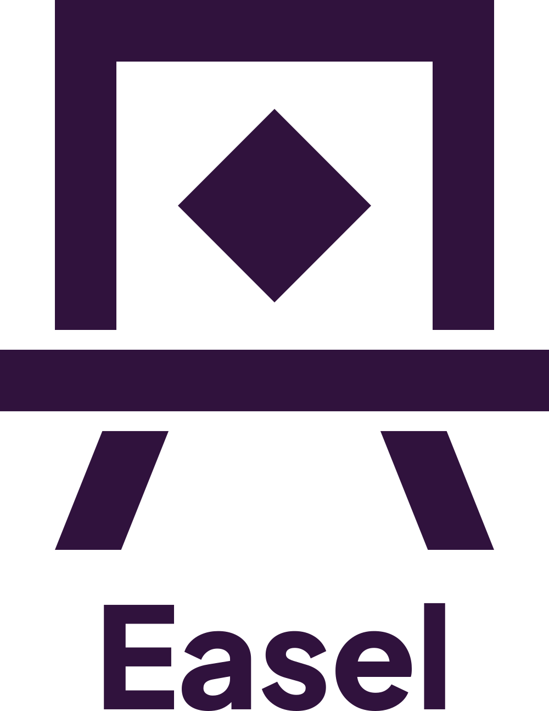

  <picture>
    <source media="(prefers-color-scheme: dark)" srcset="svg/easel-lockup-stacked-cream.svg">
    
  </picture>

# The easel logo

The mark is an easel: a frame (the canvas) holding a square on its corner (the picture), resting on a ledge, on
two splayed legs. It is built from seven numbers, not drawn by hand. [CONSTRUCTION.md](CONSTRUCTION.md) gives
the geometry, and [easel-mark-construction.svg](easel-mark-construction.svg) is the dimensioned drawing.

easel and kiln share one family: the same plum and cream, straight edges and square corners only, and the same
motif, a square on its corner.

## Colours

| Name | Hex | Use |
|---|---|---|
| plum | `#30123D` | the mark on light grounds; the dark ground |
| cream | `#F0E6DA` | the mark on dark grounds; the light icon's ground |
| paper | `#FDFBFC` | the light page |

Every pairing is far above the 3:1 that graphics need: plum on paper 15.9:1, plum on cream and cream on plum
13.0:1. Black and white are for one-colour print. The `mono` files take the colour of the surrounding text
(`currentColor`).

## Which file to use

| For | Use |
|---|---|
| A README header, light theme | `app-slots/readme-light.svg` |
| A README header, dark theme | `app-slots/readme-dark.svg` |
| An app icon on a dark ground | `app-slots/icon-dark.svg` |
| An app icon on a light ground | `app-slots/icon-light.svg` |
| A favicon | `icons/favicon.svg` |
| The mark alone | `svg/easel-plum.svg` on light grounds, `svg/easel-cream.svg` on dark ones |
| The mark with the name | `svg/easel-lockup-stacked-*.svg` (the name under the mark) or `svg/easel-lockup-horizontal-*.svg` (the name beside it) |
| The name alone | `svg/easel-wordmark-*.svg` |
| 48 px and below | `svg/easel-small-*.svg` |
| One colour | `svg/easel-mono.svg`, `svg/easel-black.svg`, `svg/easel-white.svg` |
| On a busy ground | a tile (`svg/easel-tile-*.svg`), a circle (`svg/easel-circle-*.svg`) or a knockout (`svg/easel-knockout-*.svg`) |
| Line art | `svg/easel-outline-*.svg` |
| A social preview (1200 × 630) | `icons/og-image.svg` |

Each file is cropped tight to its shape, with no padding. The mark is exactly square.

## Small sizes

At 48 px and below, use the small cut, `svg/easel-small-*.svg`. Its parameters are in
[easel-mark-small.params.json](easel-mark-small.params.json):
- its strokes are heavier (140 against 112);
- its gaps are wider (70 against 36);
- its frame is shorter.

So at 16 px the ledge stays apart from the frame and the legs, and the legs stay visible. The favicon uses it
already, and `svg/easel-small-tile-plum-rounded.svg` is a small app icon.

## The name

The name is set in Plus Jakarta Sans ExtraBold (weight 800), with the font's own kerning, and converted to
outlines: no font is needed to show it. The typeface is by the Plus Jakarta Sans Project Authors, under the SIL
Open Font License 1.1, which allows this use. The placement is fixed, and
[lockups.params.json](lockups.params.json) records it:

- **Stacked:** the cap height is 0.19 of the mark's height H, and the cap line sits 0.10 H below the mark,
  centred on its axis.
- **Horizontal:** the cap height is 0.36 H. The name starts 0.22 H after the mark, its capitals centred on the
  mark's middle.

Use these files rather than typing the name beside the mark.

## Clear space and minimum size

- Keep clear space of at least a quarter of the mark's height on every side.
- The mark: no smaller than 16 px, in the small cut.
- The stacked lockup: no smaller than 96 px tall.
- The horizontal lockup: no smaller than 40 px tall.

## Don'ts

- Don't stretch, rotate or crop the mark.
- Don't add shadows, gradients or outlines to it.
- Don't recolour it outside the palette. On a photograph or a busy ground, use a tile.
- Don't edit the files by hand. They are generated from the parameter files; to change the logo, open an issue.

## Checked

[VERIFY.txt](VERIFY.txt) records the symmetry, measured on a render at 4 pixels per unit:
- the frame sides are both 112 wide, equally far from the axis;
- the legs are equal;
- the diamond and the ledge are centred;
- the mirror image differs in 36 pixels against 15,872 edge pixels (0.2%).
